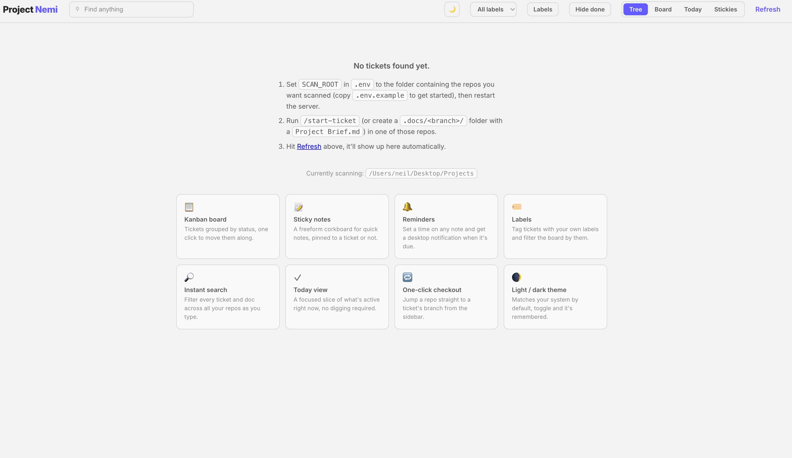
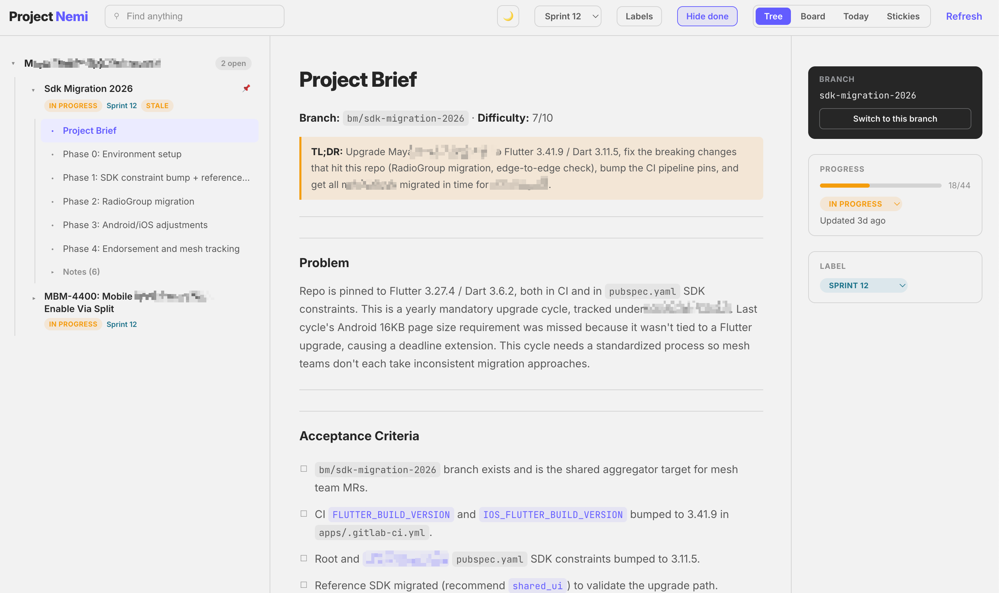
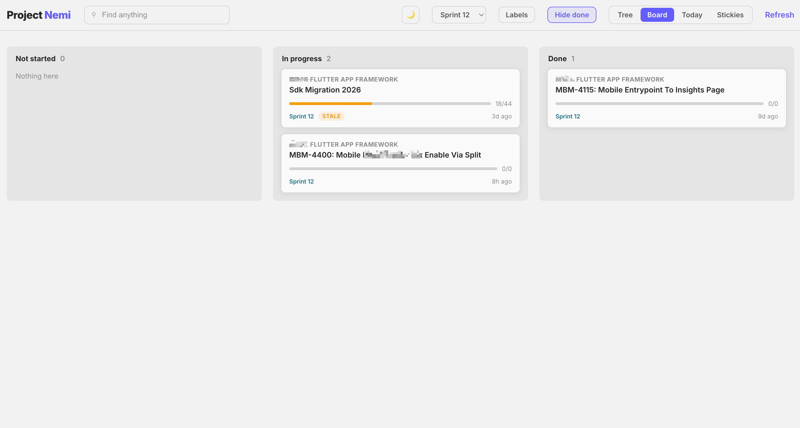
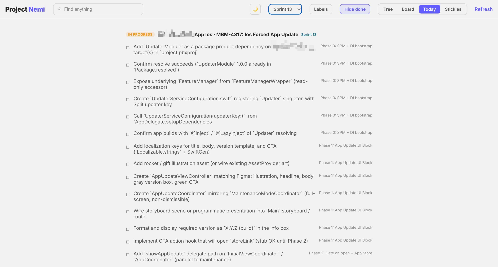
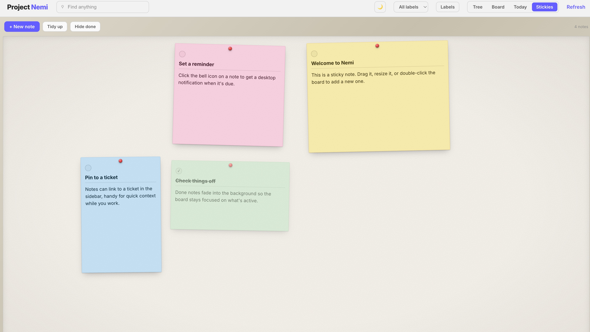

# Project Nemi

A local dashboard for tickets that live as markdown in your repos. Point it at the folder containing your projects, and it scans every git repo for a `.docs/<branch>/` folder, turning briefs, phase files, and checkboxes into a tree view, a kanban board, a "today" view, and a sticky-note corkboard, all backed by the markdown files themselves (no database).

No build step, no framework, no dependencies. One Node process, one static frontend.



## Features

- **Tree view**: sidebar of every scanned repo and its tickets, with a doc pane and a right rail for ticket metadata.
- **Board view**: kanban by status, drag-free, click to update.
- **Today view**: a focused slice of what's active right now.
- **Stickies (corkboard)**: freeform sticky notes with drag/resize, a small markdown editor, optional reminders (desktop notifications on macOS via `terminal-notifier` if installed, otherwise in-app only), and the ability to pin a note to a ticket.
- **Labels**: a small global label registry you can create, assign, and filter by.
- **Checkout from the UI**: jump a repo to a ticket's branch with one click.
- **Search**: filters across tickets and docs as you type.
- **Light/dark theme**, remembered per browser.

## Showcase

| Tree view | Board view |
|---|---|
|  |  |

| Today view | Stickies |
|---|---|
|  |  |

## Requirements

- Node.js 18+
- Git repos with a `.docs/<KEY>-<slug>/` folder holding at least one markdown file, where `<KEY>` is an issue key like `MBM-3000` (see [What counts as a ticket](#what-counts-as-a-ticket)). These are typically produced by ticket-authoring dev skills/scripts, but any folder matching that shape works. Unkeyed folders and loose markdown under `.docs/` are still browsable, just not as tickets.

## Setup

```bash
git clone <this-repo>
cd project-nemi
cp .env.example .env
```

Edit `.env` and set `SCAN_ROOT` to the absolute path of the folder containing the repos you want scanned (e.g. `/Users/you/Projects`):

```
SCAN_ROOT=/Users/you/Projects
```

Then start it:

```bash
npm start
```

Open **http://localhost:4747**. Nemi walks every git repo under `SCAN_ROOT` (up to 6 levels deep), looks for a `.docs/` folder in each, and renders whatever ticket folders it finds.

If nothing shows up, the app's empty state repeats these steps and tells you which folder it's currently scanning.

### Configuration

All config lives in `.env` (copy from `.env.example`):

| Variable | Default | Purpose |
|---|---|---|
| `SCAN_ROOT` | parent of this repo | Absolute path to the folder Nemi scans for repos |
| `PORT` | `4747` | Port the local server listens on |

## How a ticket is structured

Nemi doesn't invent its own format, it reads folders you already have:

```
your-repo/
  .docs/
    MBM-3000-fix-login/     # issue key prefix, so this folder is a ticket
      Project Brief.md      # title (# heading) + Problem Statement section
      phase-1-setup.md      # optional: **Goal:** line + checkbox tasks
      phase-2-build.md
      any-other-notes.md    # anything else in the folder is shown as a note
```

- `phase-N-*.md` files are parsed for `- [ ]` / `- [x]` checkboxes; ticket progress and status (`not-started` / `in-progress` / `done`) are derived from how many are checked.
- Checking a box, changing status, pinning, or labeling in the UI writes straight back to the markdown/JSON files, there's no separate database to get out of sync.

### What counts as a ticket

Not every folder under `.docs/` is work to be tracked. Some are just reference material, and turning those into tickets would fill your board with things that have no status and no end. So Nemi classifies each **top-level** folder under `.docs/` by name.

A folder is a **ticket** when both are true:

1. Its name starts with an issue key: one or more letters, a hyphen, then digits (`MBM-3000`, `A-300`, `B-3`). A trailing slug is fine, `MBM-3000-fix-login` still matches. The key must be at the start, and the match is case-insensitive.
2. It contains at least one `.md` file.

Anything else, an unkeyed folder, a folder with no markdown, a loose `.md` sitting directly in `.docs/`, or anything nested deeper, stays a plain **doc node**: still listed and readable in the tree, just without ticket behavior.

| Folder under `.docs/` | Classified as | Why |
|---|---|---|
| `MBM-3000/` | Ticket | Key, then digits |
| `A-300/`, `B-3/` | Ticket | Short keys are fine |
| `MBM-3000-fix-login/` | Ticket | Key at the start, slug ignored |
| `mbm-3000/` | Ticket | Case-insensitive |
| `architecture/` | Doc folder | No issue key |
| `neilmarc.com/` | Doc folder | No issue key |
| `notes-for-MBM-3000/` | Doc folder | Key is not at the start |
| `2026-08-10/` | Doc folder | Digits before the hyphen, not letters |
| `MBM-3000x/` | Doc folder | Digits must end the key or be followed by `-` |
| `MBM-3001/` with no `.md` | Doc folder | Keyed, but nothing to read |
| `scratch.md` (loose file) | Doc file | Not a folder |

### What being a ticket gets you

Doc nodes are only ever browsable text in the tree view. Promoting a folder to a ticket is what unlocks the rest of the app:

- **Board, Today, and the right rail.** These render tickets only. A doc folder never appears in any of them.
- **Progress and status.** Checkbox counts across `phase-N-*.md` roll up into a percentage and an auto-derived `not-started` / `in-progress` / `done`, overridable by hand.
- **Interactive checkboxes.** Ticking a task in the UI writes back to the markdown file.
- **Labels and pinning.** Both are keyed per ticket, so a doc folder can't carry either.
- **One-click checkout.** Nemi runs `git checkout <branch>` using the ticket's folder name as the branch, which is why the folder name matching your branch name is worth keeping.

### A brief is optional

If the folder has `Project Brief.md`, `brief.md`, or `assessment.md` (checked in that order), it becomes the ticket's overview: `# heading` for the title, `## Problem Statement` for the board excerpt.

Without one, Nemi promotes the first non-phase `.md` alphabetically instead, falling back to the first phase file. You lose the problem excerpt and the title comes from that file's `# heading`, but the ticket works. So this is enough:

```
.docs/
  B-12-spike-caching/
    findings.md           # becomes the overview, title from its # heading
```

And a ticket with no brief and no phases is still a ticket, just one with no progress bar:

```
.docs/
  A-7-triage/
    notes.md
```

## Generating tickets with AI

You don't have to write the `.docs/<branch>/` folders by hand. Give an AI coding assistant (Claude Code, Cursor, etc.) the template below as a skill, rule, or reusable prompt, and it will turn a plain ticket description into the exact file structure Nemi reads. It's generic: no reference to Nemi or any specific tool is needed in the output, it just needs to produce plain markdown in the right shape.

**Where to put it:**

- **Claude Code**: save as a skill, e.g. `.claude/skills/start-ticket/SKILL.md` in the target repo (or `~/.claude/skills/` to use it everywhere), then invoke it with `/start-ticket <description>`.
- **Cursor**: save as a project rule, e.g. `.cursor/rules/start-ticket.mdc`, or paste it into a chat as-is.
- **Anything else**: paste the template into a system prompt, custom instructions, or just the start of a chat, then follow it with your ticket description.

<details>
<summary>Click to expand the template</summary>

````markdown
# Skill: start-ticket

You turn a ticket description, bug report, or problem statement into a
`.docs/<KEY>-<slug>/` folder in the current repo, following the structure
below. The filenames and heading patterns marked **required** are parsed by
a dashboard tool that reads plain markdown, not a database, so don't deviate
from those. Everything else is a recommended shape you can adapt.

## 1. Pick a branch name

The folder name must start with an issue key: letters, a hyphen, then
digits. If the user gave you one (`MBM-3000`, `A-300`), use it. If they
didn't, ask for it rather than inventing one, the dashboard only treats
key-prefixed folders as tickets.

Follow the key with a short kebab-case slug describing the work, e.g.
`MBM-3000-fix-login-timeout`, `A-300-add-csv-export`. Create the folder:

```
.docs/<KEY>-<slug>/
```

## 2. Write the brief (required)

Create `.docs/<KEY>-<slug>/Project Brief.md`:

```markdown
# <Short, human-readable ticket title>

## Problem Statement

<What's wrong or what's needed, who it affects, and any context the
reader needs. Plain prose, no checkboxes here.>

---

## Acceptance Criteria

- [ ] <criterion>
- [ ] <criterion>

---

## Overview

<Optional. What this needs, what already exists to build on, what's
net-new. Grounded in a quick look at the codebase, not guesses.>

---

## What To Do

1. <concrete step>
2. <concrete step>

---

## Open Questions

<Optional, omit if nothing is unclear.>

- ...
```

Parsing rules (don't break these):
- The first `# heading` becomes the ticket title. **Required.**
- The `## Problem Statement` section is **required** and must use that
  exact heading text (case-insensitive). Everything under it until the
  next `##` heading or a `---` line is treated as the problem excerpt.
- Every other section above is optional structure, not a parsing
  requirement, adapt it to the ticket. Acceptance Criteria is the one worth
  always keeping: it's what "done" means, and it's what phase tasks and
  test cases should trace back to.

Writing-quality rules (generic, apply these to any ticket doc you write, not
just this one):
- Plain, dev-layman language. Someone unfamiliar with this specific corner
  of the codebase should be able to follow it. Spell out acronyms once.
- Short. Bullets and short sentences beat paragraphs. If a section runs
  past ~5 lines, cut to the essential points.
- One fact per line. If a bullet has two or more independent facts (joined
  by "and", a comma-splice, or a parenthetical carrying its own new fact),
  split it into separate bullets rather than chaining clauses.
- Concrete over abstract: name real files, functions, and screens. No
  filler like "handle edge cases appropriately."
- Omit an optional section entirely if it doesn't apply, don't leave it
  empty as a placeholder.
- Bold lead-in per bullet: start with a **bolded key term or file/function
  name**, then the detail, so scanning just the bold words gives the gist.
  E.g. `- **Login timeout**: session expires after 5 min idle, no warning
  shown.` not `- Session expires after 5 min idle and no warning is shown,
  which is the login timeout issue.`
- These rules apply for the life of the doc, not just the first draft. If
  you're asked to update it mid-implementation, keep new content in the
  same terse style rather than letting it drift into narrative paragraphs.

If you track ticket difficulty, a simple consistent scale helps at a
glance: **1-3** small, well-understood change in familiar territory.
**4-6** moderate, touches multiple files or an unfamiliar area, but a
pattern to follow exists. **7-9** large, new architecture, cross-team
coordination, or genuinely unclear scope. **10** don't start without
breaking it down further first.

## 3. Break the work into phases (optional but recommended)

For each logical phase of work, create a file named `phase-N-<slug>.md`
where `N` is a number starting at 1 (e.g. `phase-1-setup.md`,
`phase-2-implementation.md`, `phase-3-testing.md`). Phases are shown in
numeric order regardless of the slug. Only do this if the work is big
enough to benefit from chunking, skip it entirely for small, single-step
tickets.

```markdown
# Phase 1: <phase name>

**Goal:** <one sentence describing what this phase accomplishes>

## Tasks

- [ ] <task 1>
- [ ] <task 2>
- [ ] <task 3>
```

Parsing rules:
- Checkboxes must be `- [ ]` (not done) or `- [x]` / `- [X]` (done), using a
  `-` or `*` bullet. Any other bullet/checkbox syntax will not be picked up.
- The `**Goal:** ...` line is optional, if present it must be on its own
  line and start exactly with `**Goal:**`.
- Ticket progress is calculated from the ratio of checked to total
  checkboxes across all phase files, don't hand-write a progress number
  anywhere.

Writing rule: keep tasks bite-sized, each checkbox should be doable and
verifiable on its own, not "implement the feature." If a task needs its own
sub-steps to explain, it's really two tasks. Keep each phase small enough
to land as its own commit or reviewable chunk.

## 4. Add supporting notes (optional)

Any other `.md` file dropped in the same folder (not named like a brief and
not named `phase-N-*.md`) is treated as a freeform note attached to the
ticket, e.g. `research.md`, `decisions.md`, `api-notes.md`, or `Test
Cases.md`. Same rule as the brief: a leading `# Heading` becomes its
display name.

If the ticket has testable behavior (changes what the app does in response
to some input or state), a `Test Cases.md` is worth writing: group
scenarios into lettered sections, derive them like a QA engineer rather
than just listing happy-path steps, equivalence partitioning (one case per
valid/invalid class), boundary values (min, max, one-below, one-above,
empty), state transitions, and negative cases (bad input, denied
permission, timeout). Skip it entirely for pure refactors, chores, or
docs-only tickets, there's nothing observable to test.

## 5. Output checklist

Before finishing, confirm:
- [ ] Folder is `.docs/<KEY>-<kebab-case-slug>/`, starting with an issue key
      like `MBM-3000` (letters, hyphen, digits)
- [ ] Contains exactly one of `Project Brief.md`, `brief.md`, or
      `assessment.md`, with a `# Title` and a `## Problem Statement` section
- [ ] Any phase files are named `phase-<number>-<slug>.md` and use real
      `- [ ]` / `- [x]` checkboxes
- [ ] Nothing outside this folder was modified

Now use the ticket description the user provides to generate this
structure. Ask for clarification only if the description is too vague to
produce a meaningful Problem Statement.
````

</details>

Once the folder exists (on any branch, in any repo under your `SCAN_ROOT`), Nemi will pick it up on its next 5-second poll or when you click **Refresh**, no restart needed.

## Notes

- This is a local tool: it reads/writes files on disk and shells out to `git checkout` in your repos. Don't expose it beyond `localhost`.
- macOS desktop notifications for sticky note reminders use [terminal-notifier](https://github.com/julienXX/terminal-notifier) (`brew install terminal-notifier`) if it's found on your `PATH`; otherwise reminders still fire in-app.
